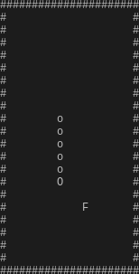

# snake

simple snake.

WASD or vim-keys to move.
X to exit

## release information
latest release is:
pre-release v0.1.1 beta.

## compiling

to compile the program, run 'make'.

check out latest release for executable.  

